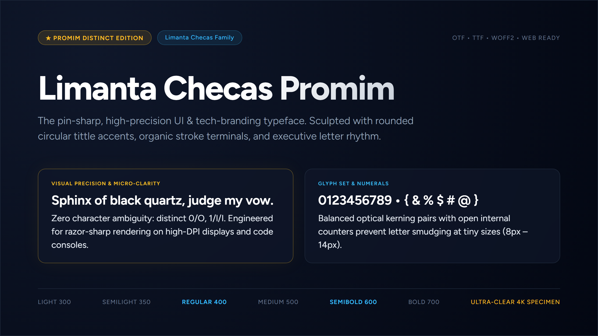

# Limanta Checas Promim — Open Source Demo

**Limanta Checas Promim** is a contemporary geometric display typeface designed with humanist craftsmanship, balanced optical rhythm, and pristine kerning. 

This repository hosts the **official open-source evaluation demo** (`opensource.zip`), providing designers and developers access to test glyph contours and explore letterforms.

---

## 📦 Demo Release Contents

- **`LimantaChecasPromim-Demo.ttf`**: Display-evaluation build containing uppercase glyphs (A–Z). Intentionally restricted to prevent continuous body text use.
- **`opensource.zip`**: Complete open-source distribution archive including the demo font, license terms, and modification notice.
- **`EULA_LICENSE_AGREEMENT.txt`**: Full foundry license terms.

---

## ⚠️ License & Modification Notice

- **Personal & Evaluation Use Only:** You may inspect vector contours and experiment with glyph modifications for personal study.
- **Modification Disclaimer:** Modifying, redistributing, or commercializing derivative works immediately voids all licenses and warranties.
- Derivative versions must not be distributed under the *"Limanta Checas"* or *"Limanta Checas Promim"* trademarks.

---

## 💎 Full Commercial Family (6 Weights)

For complete production projects requiring lowercase, full numerals, accents, extended punctuation, and all 6 optical weights:

| Weight | Classification | Intended Use |
| :--- | :--- | :--- |
| **Light** | 350 | Editorial subheadings & airy accents |
| **Semilight** | 420 | *Signature Promim* brand weight |
| **Regular** | 480 | Balanced display headings |
| **Medium** | 560 | High-legibility UI titles |
| **SemiBold** | 660 | Strong packaging & poster titles |
| **Bold** | 760 | High-impact headlines & logos |

👉 **[Get the Full Commercial Family on Gumroad](https://arpitbharadwaj6.gumroad.com/l/limantapromim)**

---

## 📬 Contact & Custom Foundry Inquiries

- **Designer:** Arpit Bharadwaj
- **Foundry:** Limanta Checas Type Foundry
- **Email:** arpitbharadwaj16@gmail.com
